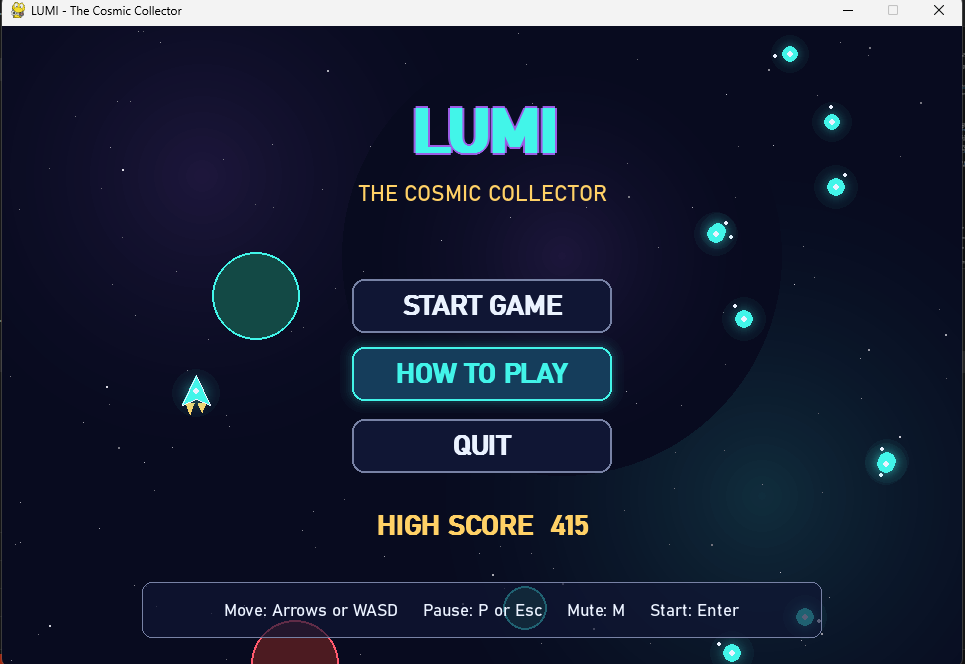

# LUMI – The Cosmic Collector

LUMI is a 2D arcade game built with Python and Pygame. You fly Lumi, a small glowing spacecraft, through a neon galaxy. Collect cyan energy orbs and golden Time Crystals, grab shields, and dodge the violet asteroids for as long as you can before the 120-second countdown ends.

## Objectives

The project demonstrates multimedia integration, animation, keyboard and mouse event handling, circle-based collision detection, score management, game states (menu, instructions, playing, paused, game over), progressive difficulty, and saving data to a local file.

## Game concept and rules

Lumi starts with three lives and a 120-second timer. The rules are:

1. Collecting a cyan energy orb gives +10 points.
2. Hitting an asteroid costs one life and 5 points. The score never drops below zero.
3. A Time Crystal gives +25 points and slows every asteroid to 40 percent speed for five seconds.
4. A blue shield pick-up absorbs the next asteroid hit and then breaks.
5. After losing a life, Lumi is invulnerable for 1.5 seconds, and the ship blinks.
6. The game ends when all lives are lost or the timer reaches zero.
7. The highest score is saved to `highscore.json` and remains after the program is restarted.

## Controls

| Action | Keys |
|---|---|
| Move | Arrow keys or W A S D |
| Pause and resume | P or Escape |
| Start or restart | Enter |
| Mute and unmute sound | M |
| Save a screenshot | F12 |
| Menu buttons | Mouse (left click) |

## Customisation mechanics

**Mechanic 1: Time Crystal.** A golden crystal appears every 20 to 25 seconds, and only one can be on screen at a time. Collecting it gives bonus points and sets a slow-motion timer. While the timer runs, every asteroid moves and spins at the reduced speed. The HUD shows a "TIME SLOW" bar that empties over five seconds. The logic is in `GameManager._collect_crystal()` and `Asteroid.update()`, and the slow factor is set in `settings.py`.

**Mechanic 2: Energy Shield.** A blue shield pick-up appears regularly. Collecting it turns Lumi's ship blue, adds a pulsing bubble, and shows "SHIELD ACTIVE" on the HUD. The next asteroid collision is absorbed with a "BLOCKED" message, and the shield then switches off. The logic is in `GameManager._collect_shield()` and `GameManager._hit_by_asteroid()`.

**Mechanic 3: Dynamic galaxy difficulty.** Difficulty is a level from 1 to 10. It rises by one every 20 seconds survived and by one for every 80 points scored. Each level makes asteroids faster, shortens the gap between spawns, and allows more asteroids on screen. The level is shown in the top-right panel. The formulas are in `GameManager._compute_level()` and `GameManager._spawn_objects()`.

## Requirements

Python 3.8 or newer and Pygame 2.5 or newer. No image files are needed, because every graphic is drawn with Pygame code. Every sound effect is generated in code as well. If you add `.wav` files to `assets/sounds/` with matching names, they replace the generated sounds. If no sound device is available, the game runs silently.

## Installation and running

```bash
pip install -r requirements.txt
python main.py
```

## Algorithm and game loop

The program has one main loop, and each pass through it has three steps.

```
create window once
create GameManager (state = MENU)
while game is running:
    dt = seconds since last frame (capped at 0.05)
    for each event in the event queue:
        handle it (keys, mouse clicks, window close)
    update(dt):
        if PLAYING:
            move player from held keys
            advance timers and recompute difficulty level
            spawn orbs, asteroids, crystals and shields when their timers expire
            move every object (asteroids slower during Time Crystal)
            check collisions and apply the rules
            remove dead objects
            if time is up: go to GAME_OVER
    draw():
        draw background, then the menu, the game world, or the overlay for the current state
        apply screen shake and display the frame
close the window, save the high score, quit
```

Delta time keeps speed constant. An object that should move 200 pixels per second moves `200 × dt` pixels each frame, whatever the frame rate is.

## Collision detection

Every object is a circle with a centre (x, y) and a radius r. Two circles overlap when the distance between their centres is smaller than the sum of their radii:

```
overlap if (x1 − x2)² + (y1 − y2)² < (r1 + r2)²
```

The code compares squared distances, which avoids the slower square-root function. Orbs, crystals, shields and asteroids are checked against Lumi's circle every frame.

## Scoring, lives and timer

Points are added for orbs (+10) and crystals (+25). Each asteroid hit subtracts 5 points, but the score is clamped at zero with `max(0, score − 5)`. Lumi loses a life only if the shield is not active and the invulnerability timer is zero. After a hit, the asteroid is destroyed, so the same collision cannot be counted twice. The timer counts down from 120 seconds and ends the match at zero.

## Multimedia elements

The game uses an animated starfield with parallax and twinkling stars, drifting planets, and a nebula drawn once and reused. Lumi has flickering engine flames, a blink during invulnerability, and a pulsing shield bubble. Orbs pulse and have orbiting sparks, the crystal spins, asteroids rotate and have craters, and particles burst on each collection and collision. Screen flash and shake show important events. Sound effects cover collection, crystal, shield, block, hit and game over, and there is looping background music with mute support.

## Demonstrating customisation during the lab test

1. Run `python main.py`, click HOW TO PLAY to show the rules, then go back and start a game.
2. Show Mechanic 3 by playing for about 30 seconds and pointing at the DIFFICULTY LEVEL number and the faster asteroids.
3. Show Mechanic 1 by collecting the golden crystal. Point at the TIME SLOW bar and the slowed asteroids.
4. Show Mechanic 2 by collecting the blue pick-up, then letting an asteroid hit Lumi and pointing at "BLOCKED".
5. To explain a change, open `settings.py`, change a value such as `CRYSTAL_SLOW_TIME = 5.0` to `8.0` or `START_LIVES = 3` to `5`, save, and run the game again.
6. Finish a game, show the game-over screen, and then restart with Enter to show that the high score is kept.

## Taking genuine screenshots

Run the game and reach each screen. Press F12 to save the current frame to the `screenshots/` folder. Each file gets a timestamp name, so rename the files you want to `start_screen.png`, `gameplay.png` and `game_over.png`. Capture the start screen from the menu, gameplay during a match with a shield or crystal active if possible, and the game-over screen after losing all lives.

## Project files

`main.py` starts the program and runs the loop. `game.py` contains the game states, rules, spawning, collisions and high-score saving. `entities.py` contains the starfield, particles, the player, collectibles, power-ups and asteroids. `ui.py` contains buttons, the HUD, screen effects and the menu and overlay screens. `audio.py` generates and plays the sounds and music. `settings.py` contains every tunable number, colour and path. `highscore.json` stores the best score.

## Feature section
## 🎮 Game Preview – LUMI: The Cosmic Collector

Explore the cosmic world of LUMI, where players collect glowing objects, avoid obstacles, and aim for the highest score!

### 🏠 Main Menu



The main menu provides options to start the game, learn the controls, quit, and view the highest score.
